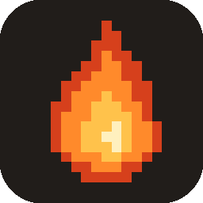
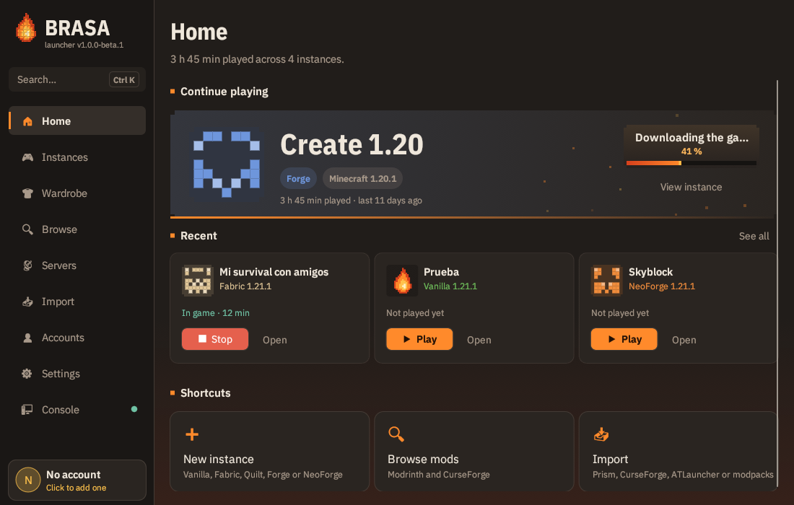
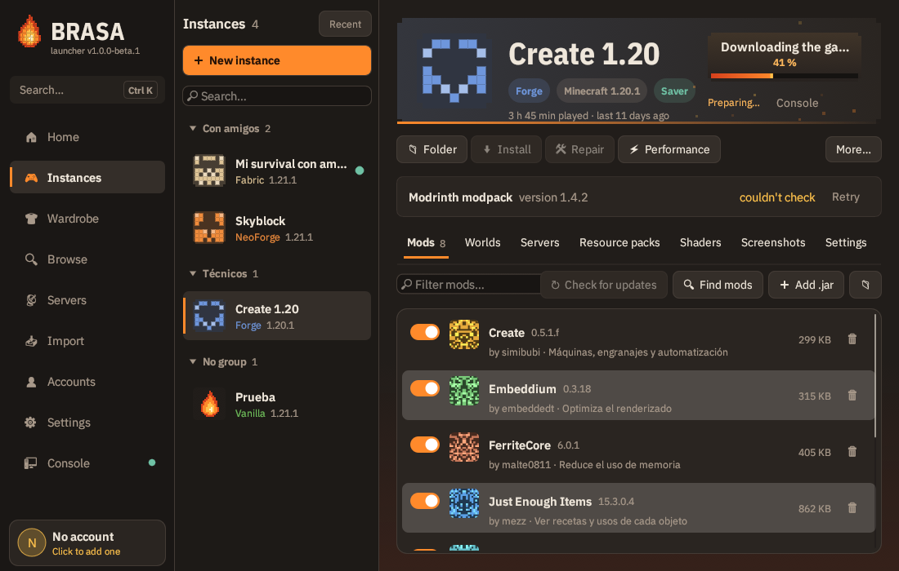
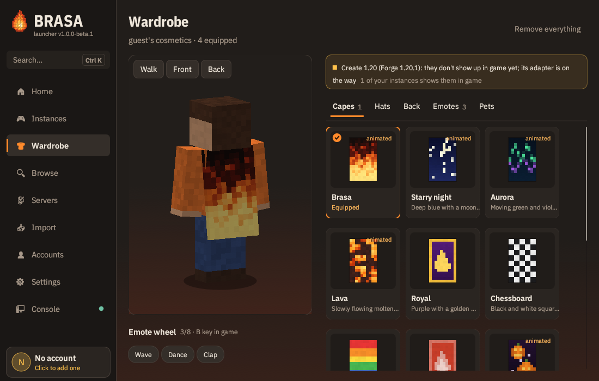

<div align="center">



# Brasa Launcher

A fast, native launcher for **Minecraft: Java Edition**, written in Rust.

[](https://github.com/Piratemajo/brasa/actions/workflows/build.yml)
[](LICENSE)
[](https://github.com/Piratemajo/brasa-releases/releases)



</div>

Brasa ships as one self-contained binary for Windows, macOS and Linux. Each instance has its own
mods, worlds and settings, and mod loaders, Modrinth and CurseForge are built in. The interface is
available in English and Spanish.

> Brasa is not an official Minecraft product. It is not approved by or associated with Mojang or
> Microsoft.

## Features

- **Instances.** Every instance is fully isolated, with its own memory, Java and launch options.
  Organise them in groups, duplicate them, and see your play time.
- **Mod loaders.** Install Fabric, Quilt, Forge and NeoForge in one click.
- **Content.** Get mods, resource packs and shaders from **Modrinth** and **CurseForge**, with
  dependencies resolved automatically and updates found by file hash.
- **Modpacks.** Import and export `.mrpack` and CurseForge `.zip` packs, and update an installed
  pack without losing your own changes.
- **Accounts.**
  - Microsoft accounts. If the account doesn't own the game, it launches in demo mode.
  - Offline accounts.
  - Accounts on Yggdrasil servers such as Ely.by and LittleSkin, through authlib-injector.
- **Java.** Brasa uses the Java you already have installed and only downloads Temurin when none of
  them is compatible.
- **Reliable downloads.**
  - Downloads run in parallel, are checked with SHA-1 and are written atomically.
  - Failed requests are retried over IPv4 and through mirrors.
  - Proxies are supported.
  - A built-in network diagnostic shows which service is failing.
- **Repair.** Every file is checked again and only the broken ones are downloaded.
- **World backups.** Changed worlds are backed up automatically before you play, and you can
  restore one in a click. Restoring never deletes the current world.
- **Crash diagnosis.** Common failures are recognised from the log and the crash report, with a
  suggested fix:
  - the wrong Java version;
  - running out of memory;
  - Mixin errors;
  - missing dependencies;
  - graphics drivers.
- **Performance.** Memory is sized automatically from your RAM, Minecraft version and mod count.
  An optional low-spec mode turns down the heaviest video settings.
- **Server hosting.** Run Vanilla, Paper, Fabric or NeoForge/Forge servers from the launcher, with
  plugins and mods from Modrinth.
- **Brasa P2P.** Friends join your server with a personal invite code, with no port forwarding
  needed. The connection is encrypted QUIC, peer to peer when the network allows and through a
  relay when it doesn't.
- **Wardrobe.** Original capes, hats, pets and emotes, drawn in game by a small Fabric mod.
- **Importers.** Bring in your existing instances from Prism Launcher, MultiMC, the CurseForge app,
  ATLauncher and the official launcher.
- **Everything else:**
  - Discord Rich Presence;
  - signed self-updates;
  - tokens kept in the OS keychain;
  - a full CLI.

<table>
  <tr>
    <td></td>
    <td></td>
  </tr>
  <tr>
    <td align="center">Instances and mods</td>
    <td align="center">Wardrobe</td>
  </tr>
</table>

## Install

Download the latest build for your platform from the
[releases page](https://github.com/Piratemajo/brasa-releases/releases):

| Platform | File |
|---|---|
| Windows (x64) | `Brasa-Setup-windows-x64.exe` (installer) or `brasa-windows-x64.exe` (portable) |
| macOS (Apple silicon) | `brasa-macos-arm64` |
| Linux (x64) | `brasa-linux-x64` |

Every file comes with a `.sha256` checksum. Once installed, Brasa updates itself and verifies each
update against its checksum.

## Build from source

You need Rust **1.91** or newer. On Linux you also need the usual windowing development packages:

```sh
sudo apt install libxkbcommon-dev libgl1-mesa-dev libwayland-dev \
  libxcb-render0-dev libxcb-shape0-dev libxcb-xfixes0-dev
```

Then build and run it:

```sh
cargo build --release --locked
./target/release/brasa
```

A plain source build works, but Microsoft sign-in, CurseForge and Discord stay disabled until you
provide their IDs at build time. [`docs/RELEASING.md`](docs/RELEASING.md) explains how.

## Command line

Run without arguments, `brasa` opens the GUI. Everything the GUI does is also available from the
command line:

```sh
brasa create "Survival" -v 1.21.1 -l fabric   # new instance with Fabric
brasa add survival sodium                     # mod + dependencies from Modrinth
brasa update survival --dry-run               # check mod updates
brasa modpack fabulously-optimized            # install a modpack as a new instance
brasa login                                   # Microsoft account
brasa launch survival --server play.example.com
brasa repair survival
brasa backup survival                         # back up every world
brasa net-test                                # connectivity diagnostic
```

Run `brasa --help` for the full list.

Data lives in your platform's data directory:

| Platform | Location |
|---|---|
| Windows | `%APPDATA%\brasa` |
| Linux | `~/.local/share/brasa` |
| macOS | `~/Library/Application Support/dev.brasa.brasa` |

You can also choose the location with `BRASA_HOME`.

## Documentation

- [User guide](docs/GUIDE.md): accounts, performance, backups, the Wardrobe, servers and shortcuts.
- [Architecture](docs/ARCHITECTURE.md): how the code is organised.
- [Releasing](docs/RELEASING.md): build-time configuration, CI and publishing.
- [Contributing](CONTRIBUTING.md), [security policy](SECURITY.md) and [privacy](PRIVACY.md).

## License

Brasa is released under the [MIT license](LICENSE). Third-party components and their licenses are
listed in [`THIRD_PARTY_NOTICES.md`](THIRD_PARTY_NOTICES.md).

"Minecraft" is a trademark of Mojang Synergies AB. The cosmetics included with Brasa are original
designs.
